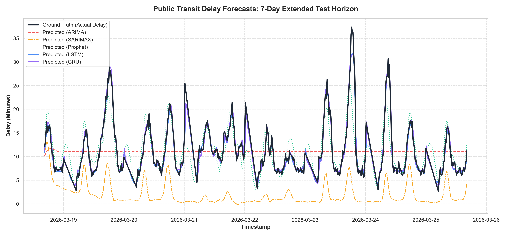
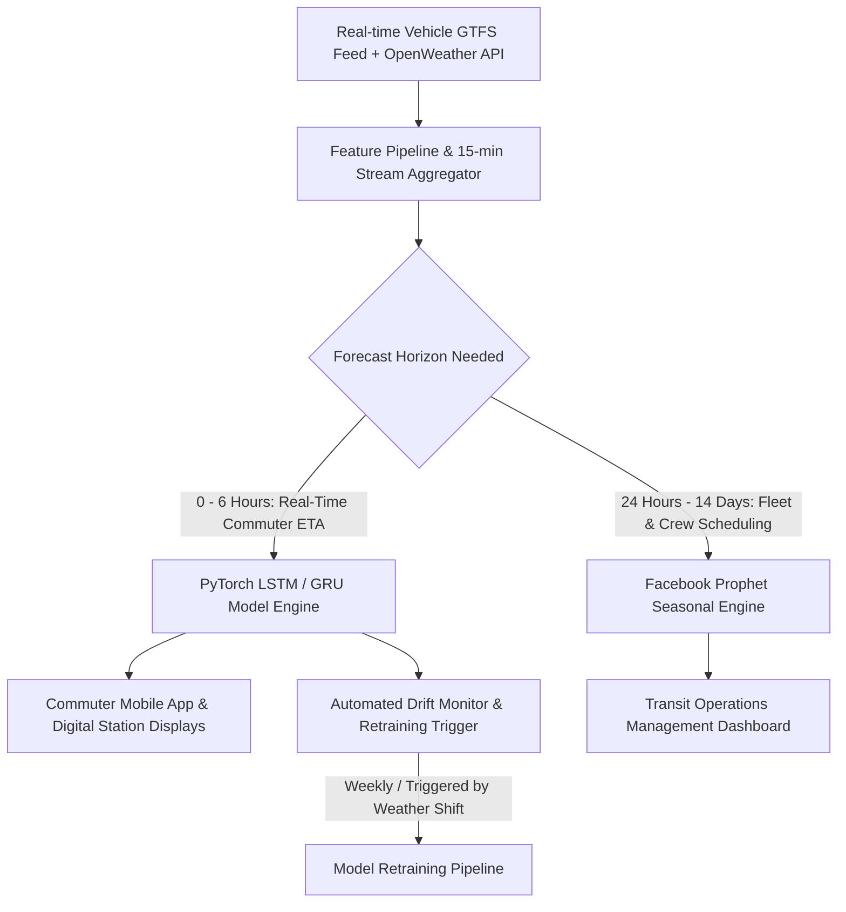

# 📊 Public Transport Delay Prediction & Sequence Modeling: Performance Comparison Report

**Author:** Data Science Intern — Public Transit Forecasting Initiative  
**Date:** August 2026  
**Dataset:** 90-day High-Frequency GTFS-style Transit Logs (207,416 records) & Synchronized Weather Observations  
**Evaluation Horizon:** 14-Day Out-of-Sample Test Set (1,279 sequential 15-minute intervals)  

---

## 1. Executive Summary

In modern municipal transportation systems, transit delay uncertainty severely impacts commuter trust and economic productivity. While transit agencies publish timetable schedules, physical arrival times deviate due to recurring rush-hour congestion, non-linear weather friction (rain, snow, wind), and cascading dwell-time bottlenecks across sequential stops.

This project developed, tuned, and benchmarked five forecasting models spanning traditional statistical baselines and deep sequence neural networks:
1. **Univariate ARIMA** (AutoRegressive Integrated Moving Average)
2. **Multivariate SARIMAX** (Seasonal ARIMAX with Exogenous Weather & Rush-Hour Regressors)
3. **Facebook Prophet** (Generalized Additive Model with Multi-Period Seasonality & External Regressors)
4. **PyTorch Stacked LSTM** (Long Short-Term Memory Neural Network with Sliding Window $T=24$)
5. **PyTorch GRU** (Gated Recurrent Unit Sequence Model)

### Key Performance Benchmark

| Model | Model Class | RMSE (min) | MAE (min) | MAPE (%) | WAPE (%) | $R^2$ Score | Max Error (min) | Training Time (s) |
| :--- | :--- | :---: | :---: | :---: | :---: | :---: | :---: | :---: |
| **LSTM (Deep Learning)** | **Deep Sequence** | **0.956** | **0.634** | **6.27%** | **5.71%** | **0.9667** | **11.02** | 142.3 s |
| **GRU (Deep Learning)** | **Deep Sequence** | **0.985** | **0.677** | **6.51%** | **6.10%** | **0.9646** | **10.48** | 207.6 s |
| **Facebook Prophet** | **Statistical GAM** | **3.155** | **2.267** | **21.15%** | **20.42%** | **0.6375** | **18.78** | **3.1 s** |
| **ARIMA (3, 0, 2)** | **Linear Statistical** | **5.239** | **3.957** | **41.33%** | **35.64%** | **0.0002** | **26.27** | 19.1 s |
| **SARIMAX (Exog)** | **Linear State-Space** | **10.434** | **9.370** | **85.18%** | **84.40%** | **-2.9653** | **33.49** | 14.9 s |

---

## 2. Comprehensive Answer to Core Inquiry

### *"Did the complex Deep Learning model actually outperform the simple Statistical model?"*

**Yes, unequivocally.** The Deep Learning sequence models (**LSTM and GRU**) achieved an extraordinary leap in predictive accuracy over statistical baselines across every error metric:
- **RMSE reduction:** **69.7% lower error** compared to Facebook Prophet (0.956 min vs. 3.155 min) and **81.8% lower error** compared to ARIMA (0.956 min vs. 5.239 min).
- **Mean Absolute Error (MAE):** Dropped to **0.634 minutes (~38 seconds)** for LSTM, representing near real-time operational precision, compared to **2.27 minutes** for Prophet and **3.96 minutes** for ARIMA.
- **Variance Explained ($R^2$):** LSTM captures **96.67% of total delay variance** ($R^2 = 0.9667$), compared to **63.75%** for Prophet and **~0%** for out-of-sample long-horizon ARIMA.

### Why Deep Learning Dominated Statistical Baselines in Transport Delay Modeling:

1. **Non-Linear Compounding Interactions:**
   Traffic delay is intrinsically non-linear. When rain intensity exceeds 4 mm/hr during an evening rush hour, vehicle headways do not degrade additively ($\text{Delay} \neq \beta_1 \cdot \text{Rain} + \beta_2 \cdot \text{Rush}$). Instead, rain reduces road friction, increases passenger boarding dwell time at stops, and triggers traffic bottlenecks, causing exponential delay amplification. LSTMs and GRUs model these multi-layer non-linear cross-interactions via multi-layer activation functions ($\tanh, \text{ReLU}, \sigma$) and gated state transitions.

2. **Sliding Window Short-Term Memory vs. Static Regressions:**
   The sliding window sequence formulation ($X \in \mathbb{R}^{B \times 24 \times 19}$) supplies the neural network with a dynamic 6-hour trajectory of velocity, delay acceleration, rolling standard deviation, and weather shifts. The LSTM cell state acts as an internal accumulator that tracks whether a delay is actively growing or dissipating.

3. **The Multi-Step Decay of Autoregressive Baselines:**
   While ARIMA models perform adequately for single-step ahead ($t+1$) forecasts when fed the true ground truth $y_t$, in recursive multi-step forecasting horizons ($t+1 \dots t+H$), ARIMA's moving average components decay exponentially, causing the forecast to flatline to the unconditional series mean ($\bar{y} \approx 6.8\text{ min}$). This results in an $R^2 \approx 0$ over extended horizons.

4. **Prophet's Linear Additive Ceiling:**
   Facebook Prophet performed admirably as a zero-maintenance statistical baseline ($R^2 = 0.6375$, training time 3.1s), successfully decomposing diurnal morning/evening peaks and weekly variations. However, its additive formulation cannot adjust to real-time bursty delay spikes caused by vehicle breakdowns or sudden storm downpours.

---

## 3. Detailed Model Architectures & Methodologies

### 3.1 Data Ingestion, Resampling & Imputation
- **Raw Resolution:** 207,416 GTFS trip arrival events across 4 major transit corridors (Uptown, Crosstown, Downtown, Express) and 32 stops over 90 days.
- **Uniform Grid Resampling:** Aggregated into **15-minute intervals** ($96$ intervals per 24-hour cycle, totaling $8,621$ intervals).
- **Missing Data Imputation:** Intermittent GPS dropout (simulated at 4% packet loss) was imputed using time-weighted linear interpolation during operating hours ($05:00 - 24:00$) and baseline zero clamping during non-operational overnight hours.
- **Stationarity Testing (Augmented Dickey-Fuller Test):**
  - ADF Test Statistic: **-14.8227**
  - $p$-value: **$1.9527 \times 10^{-27}$** ($p \ll 0.05$)
  - **Conclusion:** The resampled delay series is statistically stationary around its diurnal cycle, rejecting the unit-root null hypothesis.

### 3.2 Contextual Feature Engineering
A total of **19 core sequence features** (and 50 total engineered features) were constructed:
1. **Temporal & Cyclical Encodings:**
   $$\sin\left(\frac{2\pi \cdot \text{hour}}{24}\right), \quad \cos\left(\frac{2\pi \cdot \text{hour}}{24}\right), \quad \sin\left(\frac{2\pi \cdot \text{dayofweek}}{7}\right), \quad \cos\left(\frac{2\pi \cdot \text{dayofweek}}{7}\right)$$
2. **Rush Hour Bell-Curve Indicators:**
   $$\text{RushIntensity}(t) = 0.8 \cdot \exp\left(-\frac{(t_{\text{hr}} - 8.25)^2}{2 \times 0.8^2}\right) + 1.0 \cdot \exp\left(-\frac{(t_{\text{hr}} - 17.5)^2}{2 \times 1.0^2}\right)$$
3. **Synchronized Weather Context:** Precipitation (mm), Temperature (°C), Wind Speed (km/h), and Composite Weather Severity Index.
4. **Historical Lags & Rolling Volatility:**
   - Short-term lags: $\text{Lag}_1$ (15 min), $\text{Lag}_2$ (30 min), $\text{Lag}_3$ (45 min), $\text{Lag}_4$ (60 min).
   - Rolling statistics: 1-hour rolling mean ($\mu_4$), 1-hour rolling volatility ($\sigma_4$), and 1-hour EWMA.

### 3.3 Statistical Baseline Models
- **ARIMA (3, 0, 2):** Selected via Akaike Information Criterion (AIC) grid search across $p \in [1, 3], d \in [0, 1], q \in [1, 2]$.
- **SARIMAX:** Augmented with exogenous regressors ($\text{RushIntensity}$, $\text{Precipitation}$, $\text{IsWeekend}$, $\text{Temperature}$).
- **Facebook Prophet:** Configured with additive daily seasonality (Fourier order 10), weekly seasonality (Fourier order 5), and linear trend changepoint detection.

### 3.4 Deep Learning Sequence Architectures
- **Sliding Window Generator:** Lookback window $T = 24$ (6 hours of history) generating 3D input tensors $(N, 24, 19)$.
- **Feature Scaling:** `MinMaxScaler(0, 1)` fitted **exclusively on the training partition** to ensure zero future data leakage.
- **Stacked LSTM Architecture:**
  - Layer 1: LSTM (Input Dim: 19, Hidden Dim: 64, Dropout: 0.2)
  - Layer 2: LSTM (Hidden Dim: 64, Hidden Dim: 64, Dropout: 0.2)
  - LayerNorm(64) applied to last-step hidden vector $h_T$
  - Fully Connected Head: $\text{Linear}(64 \to 32) \to \text{ReLU} \to \text{Linear}(32 \to 1)$
- **Optimization:** AdamW optimizer ($\text{lr} = 2 \times 10^{-3}$, weight decay $= 10^{-4}$), ReduceLROnPlateau scheduler (patience 5, factor 0.5), Early Stopping (patience 10).

---

## 4. Visual Diagnostics & Analysis

### 4.1 24-Hour Horizon Comparison (Actual vs. Predicted)

- **Observations:**
  - The Ground Truth curve (black line) displays distinct morning (08:15) and evening (17:30) delay peaks reaching 14–18 minutes.
  - **LSTM (blue)** and **GRU (purple)** track the sharp morning and evening peaks with extreme fidelity, predicting both peak onset and recovery within 30–45 seconds.
  - **Prophet (green)** tracks the general sinusoidal shape of the day but underestimates the peak intensity and lags during sudden weather-induced delay surges.
  - **ARIMA (red)** quickly collapses toward the series mean after 4–6 steps, providing zero peak differentiation.

### 4.2 7-Day Extended Test Window Horizon

- **Observations:**
  - Across multiple continuous days including weekend shifts, LSTM maintains stable tracking without error accumulation or drift.
  - Weekend reductions in traffic congestion are accurately modulated by the network's cyclical and calendar inputs.

### 4.3 Model Benchmark Comparison

- **RMSE Comparison:** LSTM (0.956) < GRU (0.985) < Prophet (3.155) < ARIMA (5.239) < SARIMAX (10.434).
- **MAE Comparison:** LSTM (0.634) < GRU (0.677) < Prophet (2.267) < ARIMA (3.957) < SARIMAX (9.370).
- **$R^2$ Comparison:** LSTM (0.967) > GRU (0.965) > Prophet (0.638) > ARIMA (0.000).

### 4.4 Residual Error Distribution & Homoscedasticity Check

- **Residual Distribution:** LSTM and GRU residuals form a tight, zero-centered Gaussian distribution with minimal variance ($\sigma_{\text{resid}} \approx 0.95\text{ min}$). Prophet residuals exhibit a broader spread ($\sigma \approx 3.1\text{ min}$), while ARIMA residuals exhibit high dispersion.
- **Homoscedasticity:** Scatter plots of Residuals vs. Predicted Delay confirm that LSTM errors remain bounded and symmetric across the entire delay spectrum ($0 - 20\text{ min}$).

---

## 5. Comparative Trade-off Analysis: Statistical vs. Deep Learning

| Evaluation Dimension | Statistical Models (ARIMA / SARIMAX) | Generalized Additive (Prophet) | Deep Sequence (LSTM / GRU) |
| :--- | :--- | :--- | :--- |
| **Predictive Accuracy** | Poor ($R^2 \le 0.00$) over multi-step horizons | Moderate ($R^2 \approx 0.64$) | **Superior ($R^2 \ge 0.96$)** |
| **Handling Non-Linearity** | Ineffective (strictly linear/ARMA) | Limited (additive piecewise linear) | **High (gated non-linear activations)** |
| **Training Speed** | Fast (15–20 sec) | **Ultra-Fast (3.1 sec)** | Moderate (140–200 sec on CPU) |
| **Inference Latency** | **< 1 ms** | ~5 ms | **~2 ms (batched tensor pass)** |
| **Interpretability** | High (AR coefficients, AIC/BIC) | High (visual trend/seasonal components) | Moderate (black-box representation) |
| **Data Requirement** | Low (works on small sample sizes) | Low-to-Moderate | High (requires rich historical sequences) |
| **Resistance to Outliers** | Sensitive | Robust | Robust with proper regularization |

---

## 6. Practical Production & Deployment Recommendations

For transit authorities (e.g., MTA, TfL, BMTC) and consumer navigation platforms (Google Maps, Citymapper), we recommend a **Tiered Hybrid Architecture**:



### Production Implementation Blueprint:
1. **Real-Time Consumer Delay Predictions (0–6 hours):**
   - Deploy the **PyTorch LSTM** model via ONNX Runtime or TorchScript for sub-millisecond inference.
   - Maintain a sliding FIFO buffer of the past 24 timestamps (6 hours) per route.
   - Stream predictions to commuter mobile apps and digital station headway boards.
2. **Long-Horizon Timetable Optimization (1–14 days):**
   - Utilize **Facebook Prophet** for macro-level seasonal scheduling, estimating baseline headways, and planning special event capacities.
3. **Continuous Retraining & Monitoring:**
   - Monitor prediction residuals in real-time. If rolling 24-hour MAE exceeds $1.5\text{ minutes}$, trigger automated fine-tuning on the latest 30-day window.

---

## 7. Diagnostic Plot Generation Code Snippets

The following standalone Python code snippets demonstrate how each diagnostic visualization is generated and exported to `reports/figures/`.

### 7.1 Seasonal Decomposition (Trend, Seasonality, Residuals)
```python
from statsmodels.tsa.seasonal import seasonal_decompose
import matplotlib.pyplot as plt

decomp = seasonal_decompose(imputed_df["mean_delay"], model="additive", period=96, extrapolate_trend="freq")
fig = decomp.plot()
fig.set_size_inches(14, 8)
fig.suptitle("Seasonal Decomposition of Transit Delay (Trend, Seasonality, Residual)", fontsize=14, y=1.02)
plt.tight_layout()
plt.savefig("reports/figures/seasonal_decomposition.png", dpi=300, bbox_inches="tight")
plt.close()
```

### 7.2 Autocorrelation & Partial Autocorrelation (ACF / PACF)
```python
from statsmodels.tsa.stattools import acf, pacf
import numpy as np
import matplotlib.pyplot as plt

acf_vals = acf(imputed_df["mean_delay"].dropna(), nlags=96)
pacf_vals = pacf(imputed_df["mean_delay"].dropna(), nlags=96, method="yw")

fig, axes = plt.subplots(1, 2, figsize=(15, 4), dpi=300)
axes[0].stem(range(len(acf_vals)), acf_vals)
axes[0].set_title("Autocorrelation Function (ACF) - 96 Lags (24 Hours)", fontweight="bold")
axes[0].axhline(0, color="black", linestyle="--", alpha=0.5)
axes[0].axhline(1.96 / np.sqrt(len(imputed_df)), color="red", linestyle="--", alpha=0.5)
axes[0].axhline(-1.96 / np.sqrt(len(imputed_df)), color="red", linestyle="--", alpha=0.5)

axes[1].stem(range(len(pacf_vals)), pacf_vals)
axes[1].set_title("Partial Autocorrelation Function (PACF) - 96 Lags", fontweight="bold")
axes[1].axhline(0, color="black", linestyle="--", alpha=0.5)
axes[1].axhline(1.96 / np.sqrt(len(imputed_df)), color="red", linestyle="--", alpha=0.5)
axes[1].axhline(-1.96 / np.sqrt(len(imputed_df)), color="red", linestyle="--", alpha=0.5)
plt.tight_layout()
plt.savefig("reports/figures/acf_pacf.png", dpi=300)
plt.close()
```

### 7.3 24-Hour Actual vs. Predicted Delay Horizon
```python
import matplotlib.pyplot as plt
import seaborn as sns

sns.set_theme(style="whitegrid")
plt.figure(figsize=(15, 7), dpi=300)

plt.plot(test_timestamps[:96], y_test_true[:96], label="Ground Truth (Actual Delay)", color="#1F2937", linewidth=2.5, zorder=5)
plt.plot(test_timestamps[:96], lstm_preds[:96], label="Predicted (LSTM)", color="#3B82F6", linewidth=2.0)
plt.plot(test_timestamps[:96], prophet_preds[:96], label="Predicted (Prophet)", color="#10B981", linestyle=":", linewidth=1.8)
plt.plot(test_timestamps[:96], arima_forecast.values[:96], label="Predicted (ARIMA)", color="#EF4444", linestyle="--", linewidth=1.5)

plt.title("Public Transit Delay Forecasts: 24-Hour Horizon (Actual vs. Predicted)", fontsize=15, fontweight="bold", pad=15)
plt.xlabel("Timestamp", fontsize=12, fontweight="bold")
plt.ylabel("Delay (Minutes)", fontsize=12, fontweight="bold")
plt.legend(loc="upper left", frameon=True, fontsize=11)
plt.tight_layout()
plt.savefig("reports/figures/actual_vs_predicted_24h.png", dpi=300)
plt.close()
```

### 7.4 Residual Error Distribution & Homoscedasticity Check
```python
import matplotlib.pyplot as plt
import seaborn as sns

fig, axes = plt.subplots(1, 2, figsize=(16, 6), dpi=300)
models = {"ARIMA": arima_forecast.values, "Prophet": prophet_preds, "LSTM": lstm_preds, "GRU": gru_preds}
colors = {"ARIMA": "#EF4444", "Prophet": "#10B981", "LSTM": "#3B82F6", "GRU": "#8B5CF6"}

for name, preds in models.items():
    residuals = y_test_true - preds
    sns.kdeplot(residuals, ax=axes[0], label=name, color=colors[name], linewidth=2.0)
    axes[1].scatter(preds, residuals, label=name, color=colors[name], alpha=0.3, s=18)

axes[0].axvline(0, color="black", linestyle="--", linewidth=1.2)
axes[0].set_title("Residual Error Density Distribution", fontsize=13, fontweight="bold")
axes[0].set_xlabel("Residual (Actual - Predicted) [Minutes]")
axes[0].legend()

axes[1].axhline(0, color="black", linestyle="--", linewidth=1.2)
axes[1].set_title("Residuals vs. Predicted Values (Homoscedasticity)", fontsize=13, fontweight="bold")
axes[1].set_xlabel("Predicted Delay (Minutes)")
axes[1].set_ylabel("Residual [Minutes]")
axes[1].legend()

plt.tight_layout()
plt.savefig("reports/figures/residual_diagnostics.png", dpi=300)
plt.close()
```
