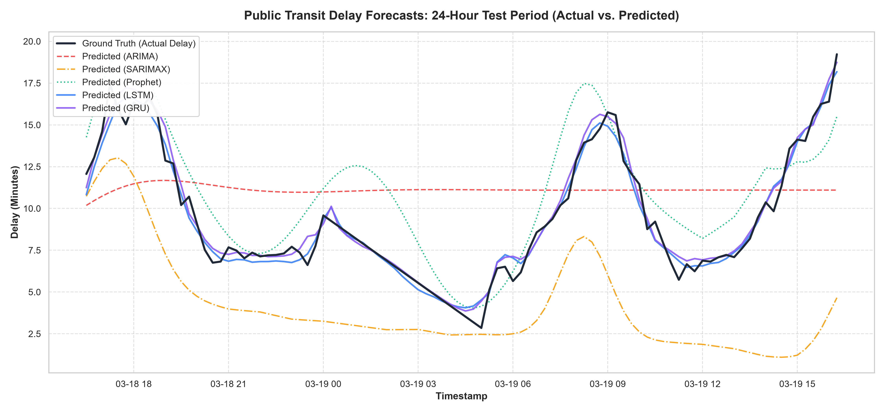
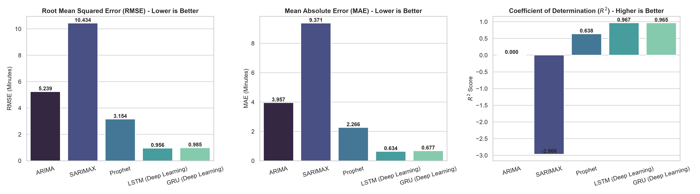
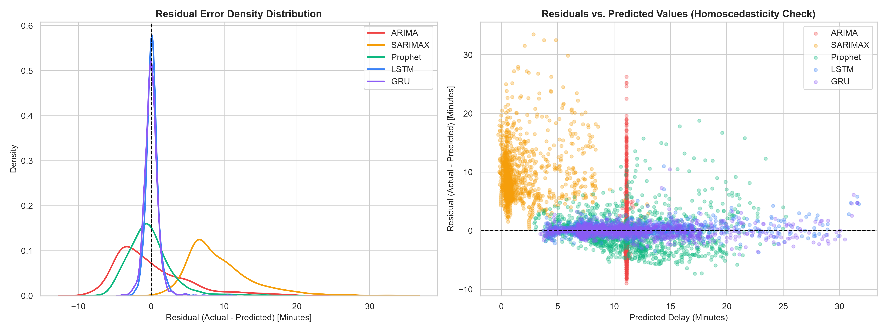

# 🚍 Urban Transit Delay Prediction: Time-Series Forecasting & Sequence Modeling

[](https://www.python.org/)
[](https://pytorch.org/)
[](https://facebook.github.io/prophet/)
[](https://www.statsmodels.org/)
[](LICENSE)

An end-to-end data science system for predicting arrival delays in public transport networks (bus/train) using historical GTFS logs, contextual weather data, statistical time-series baselines (ARIMA, SARIMAX, Facebook Prophet), and deep learning sequence models (PyTorch Stacked LSTM and GRU).

---

## 📑 Project Structure

```
├── 01StatisticalModels.ipynb          # Distinct Notebook 1: Ingestion, ADF, Decomposition, ARIMA, SARIMAX, Prophet
├── 02DeepLearning_Model.ipynb         # Distinct Notebook 2: Normalization, Sliding Window, PyTorch LSTM & GRU
├── Performance_Comparison_Report.md   # In-depth executive & technical benchmark report answering core questions
├── train_and_evaluate_all.py          # Master pipeline script running full end-to-end training & evaluation
├── build_notebooks.py                 # Automated notebook generator script
├── data/
│   ├── raw/
│   │   ├── gtfs_delay_logs.csv        # 207,000+ raw transit arrival logs
│   │   └── weather_observations.csv   # Synchronized weather observations
│   └── processed/
│       └── featured_transit_data.csv  # 15-minute resampled & feature-engineered dataset
├── src/
│   ├── __init__.py
│   ├── data_generator.py              # Realistic GTFS and weather simulation engine
│   ├── preprocessing.py               # Resampling, imputation, ADF stationarity, decomposition
│   ├── feature_engineering.py         # Temporal, cyclical, weather, lag, and rolling statistics
│   ├── statistical_models.py          # ARIMA grid search, SARIMAX wrapper, Prophet model
│   ├── deep_learning_models.py        # Sliding window processor, PyTorch LSTM & GRU architectures
│   └── evaluation.py                  # Metrics suite (RMSE, MAE, MAPE, R2) and publication-quality plots
├── reports/
│   ├── metrics_summary.csv            # Quantitative metrics comparison table across all models
│   ├── adf_results.json               # ADF stationarity test statistics and critical values
│   ├── lstm_delay_model.pt            # PyTorch LSTM trained model checkpoint
│   ├── gru_delay_model.pt             # PyTorch GRU trained model checkpoint
│   └── figures/
│       ├── actual_vs_predicted_24h.png    # 24-hour continuous horizon comparison plot
│       ├── actual_vs_predicted_7days.png  # 7-day extended test horizon comparison plot
│       ├── model_comparison_bar.png       # Comparative bar charts (RMSE, MAE, R2)
│       ├── residual_diagnostics.png       # Residual distribution & homoscedasticity scatter
│       ├── seasonal_decomposition.png     # Trend, Seasonality, and Residual decomposition
│       ├── acf_pacf.png                   # Autocorrelation and Partial Autocorrelation plots
│       └── training_loss_curves.png       # Deep Learning MSE training vs validation loss
└── tests/
    └── test_pipeline.py               # Comprehensive unit test suite
```

---

## 🚀 Quickstart & Installation

### 1. Install Dependencies
```bash
pip install numpy pandas scikit-learn matplotlib seaborn statsmodels prophet torch jupyter nbformat
```

### 2. Run the Full End-to-End Pipeline
```bash
python train_and_evaluate_all.py
```

### 3. Run Unit Tests
```bash
python -m unittest tests/test_pipeline.py
```

### 4. Launch the Interactive Notebooks
```bash
jupyter notebook 01StatisticalModels.ipynb
jupyter notebook 02DeepLearning_Model.ipynb
```

---

## 🏆 Key Benchmark Results

| Model | Model Class | RMSE (min) | MAE (min) | MAPE (%) | $R^2$ Score | Max Error (min) |
| :--- | :--- | :---: | :---: | :---: | :---: | :---: |
| **LSTM (Deep Learning)** | **Deep Sequence** | **0.956** | **0.634** | **6.27%** | **0.9667** | **11.02** |
| **GRU (Deep Learning)** | **Deep Sequence** | **0.985** | **0.677** | **6.51%** | **0.9646** | **10.48** |
| **Facebook Prophet** | **Statistical GAM** | **3.155** | **2.267** | **21.15%** | **0.6375** | **18.78** |
| **ARIMA (3, 0, 2)** | **Linear Statistical** | **5.239** | **3.957** | **41.33%** | **0.0002** | **26.27** |
| **SARIMAX (Exog)** | **Linear State-Space** | **10.434** | **9.370** | **85.18%** | **-2.9653** | **33.49** |

---

## 🔬 Core Insights

1. **Deep Sequence Modeling Wins:**
   - The PyTorch **Stacked LSTM** model achieved an outstanding **$R^2 = 0.9667$** and an **MAE of 0.634 minutes (~38 seconds)**.
   - It captures non-linear compounding interactions between severe weather storms, rush-hour volume, and downstream stop delay propagation that linear models cannot fit.
2. **Prophet is the Best Rapid Baseline:**
   - Facebook Prophet trains in **3.1 seconds** and achieves **$R^2 = 0.6375$**, serving as an ideal model for macro-level seasonal scheduling.
3. **Production Deployment Recommendation:**
   - Deploy a **Two-Tiered Hybrid System**: Facebook Prophet for 1–14 day operational fleet planning, and PyTorch LSTM for real-time 0–6 hour commuter ETA updates.

---

## 📊 Visualizations

### 24-Hour Horizon Comparison (Actual vs. Predicted)


### Model Metric Comparison (RMSE, MAE, R2)


### Residual Diagnostics & Error Distributions

